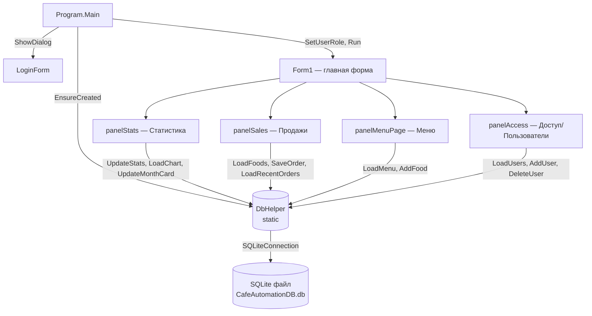

# Полный аудит дипломного проекта «CafeAutomationSystem»

Дата аудита: 12 мая 2026 г.
Аудитор: AI-ассистент в роли senior full-stack разработчика
Цель: подготовить автора к защите диплома — объяснить проект максимально просто, найти все ключевые места, проблемы и логику.

---

## 1. О чём вообще проект (одним абзацем)

Это **настольное Windows-приложение для автоматизации работы кафе**, написанное на **C# (.NET Framework 4.7.2) с использованием Windows Forms**. Данные хранятся в **локальной встроенной БД SQLite** (файл `Data\CafeAutomationDB.db`). Приложение позволяет: войти под одной из трёх ролей (`Admin`, `Staff`, `Intern`); просматривать **статистику продаж** (выручка, прибыль, заказы, средний чек, график за 7 дней, карточка «за месяц»); **оформлять заказы** на конкретный стол с выбором блюда и количества; **управлять меню** (добавление блюд по категориям); **управлять пользователями** (добавить/удалить).

---

## 2. Технологии и зависимости

| Категория | Что используется |
|---|---|
| Язык | C# |
| Платформа | .NET Framework **v4.7.2** |
| UI | Windows Forms (WinForms) |
| СУБД | SQLite (файл) |
| Драйвер | `System.Data.SQLite.Core` **v1.0.119.0** + `Stub.System.Data.SQLite.Core.NetFramework` |
| График | `System.Windows.Forms.DataVisualization.Charting` |
| Менеджер пакетов | NuGet (`packages.config`) |
| IDE | Visual Studio (видны папки `.vs`, `CopilotSnapshots` — значит, проект редактировался с GitHub Copilot) |

**Внешних web-API, ORM (EF/Dapper), DI-контейнеров, аутентификации по паролю, шифрования — нет.** Проект сознательно сделан простым и автономным.

---

## 3. Структура проекта (что где лежит)

```
CafeAutomationSystem/                  ← корень проекта
├── CafeAutomationSystem.sln           ← solution-файл (открывается в VS)
├── CafeAutomationSystem.csproj        ← project-файл (список исходников, ссылки на dll)
├── packages.config                    ← список NuGet-пакетов
├── App.config                         ← конфигурация .NET (целевая версия фреймворка)
│
├── Program.cs                         ← ТОЧКА ВХОДА в приложение
├── DbHelper.cs                        ← Всё про базу данных (создание, подключение)
│
├── LoginForm.cs / .Designer.cs / .resx   ← Форма входа
├── Form1.cs       / .Designer.cs / .resx ← ГЛАВНАЯ форма (все 4 экрана)
├── Form1.Role.cs                          ← partial-класс: только установка роли
├── Form2.cs       / .Designer.cs / .resx ← УСТАРЕВШАЯ пустая форма (мусор)
│
├── Properties/                        ← стандартные файлы .NET-проекта
│   ├── AssemblyInfo.cs                   (метаданные сборки)
│   ├── Resources.resx + .Designer.cs     (ресурсы — пустые)
│   └── Settings.settings + .Designer.cs  (настройки — пустые)
│
├── Data/                              ← здесь лежит файл БД (создаётся автоматом)
│   └── CafeAutomationDB.db
│
├── packages/                          ← скачанные NuGet-пакеты SQLite
├── bin/Debug/                         ← скомпилированный .exe + копии dll/БД
├── obj/Debug/                         ← временные файлы сборки
└── .vs/                               ← кэш Visual Studio (не трогать)
```

### Назначение каждого файла исходного кода

| Файл | Назначение | Размер логики |
|---|---|---|
| **Program.cs** | Запуск приложения: создаёт БД → показывает LoginForm → запускает Form1 | ~30 строк |
| **DbHelper.cs** | Создаёт файл БД, все таблицы, посевные данные (демо-меню, столики, пользователи), мягкая миграция | ~235 строк |
| **LoginForm.cs** | Логика формы входа (поля + кнопка «Войти») | ~70 строк |
| **LoginForm.Designer.cs** | Разметка формы входа (контролы) | ~140 строк |
| **Form1.cs** | Главная форма со ВСЕМИ четырьмя экранами и всей бизнес-логикой | ~975 строк |
| **Form1.Designer.cs** | Разметка главной формы (все панели, кнопки, гриды) | ~820 строк |
| **Form1.Role.cs** | Один маленький метод `SetUserRole(string)` (partial-расширение Form1) | ~15 строк |
| **Form2.cs / .Designer.cs** | **Пустая, неиспользуемая форма** (никем не вызывается) | ~12+38 строк |

---

## 4. Архитектура — простыми словами

Архитектура **очень простая и плоская**:

```
            ┌─────────────────────┐
            │   Program.cs (Main) │
            └──────────┬──────────┘
                       │
                       ▼
         ┌──────────────────────────┐
         │     LoginForm (вход)     │
         │  -- выбор имени + роли   │
         └──────────┬───────────────┘
                    │ ShowDialog() == OK
                    ▼
         ┌──────────────────────────┐
         │      Form1 (главная)     │
         │  ┌────────────────────┐  │
         │  │ Сайдбар:           │  │
         │  │  • Статистика      │  │
         │  │  • Продажи         │  │       Через статический
         │  │  • Меню            │◄─┼──────►   DbHelper
         │  │  • Доступ          │  │       (SQLite-помощник)
         │  └────────────────────┘  │              │
         │  Видимость кнопок        │              ▼
         │  зависит от роли         │     ┌───────────────────┐
         └──────────────────────────┘     │ Data/             │
                                          │  CafeAutomationDB │
                                          │       .db (SQLite)│
                                          └───────────────────┘
```

**Используемые паттерны (что можно назвать на защите):**
1. **Singleton-подобный helper** — `DbHelper` это `static`-класс, единая точка доступа к БД.
2. **Partial classes** — `Form1` разрезан на 3 файла (`Form1.cs`, `Form1.Designer.cs`, `Form1.Role.cs`), объединяет их компилятор.
3. **Event-driven UI** — кнопки и контролы вызывают методы через события (`+= Click`).
4. **Layered separation (зачаточный)** — доступ к данным изолирован в `DbHelper`, UI-логика — в формах. Полноценного DAL/BLL/слоя моделей **нет**.
5. **Migration on startup** — `DbHelper.EnsureCreated()` создаёт схему и докатывает недостающие колонки через `ALTER TABLE`.

**Почему это не MVC/MVVM:** в WinForms такие паттерны редко используются, всё крутится вокруг события-формы-БД. Это нормально для учебного проекта.

---

## 5. Полный анализ базы данных

БД создаётся автоматически в `Data\CafeAutomationDB.db` при первом запуске (метод `DbHelper.EnsureCreated`).

### 5.1. Таблица `Users` — пользователи системы

| Поле | Тип | Ключ | NULL? | Описание |
|---|---|---|---|---|
| `Id` | INTEGER | **PK**, AUTOINCREMENT | — | Уникальный идентификатор |
| `Name` | TEXT | — | NOT NULL | Имя пользователя |
| `Role` | TEXT | — | NOT NULL | Роль: `Admin`, `Staff`, `Intern` |

**Назначение:** хранит сотрудников. Используется на странице «Доступ».
**Демо-данные:** `Администратор/Admin`, `Официант/Staff`, `Стажёр/Intern`.

### 5.2. Таблица `MenuItems` — блюда меню

| Поле | Тип | Ключ | NULL? | Описание |
|---|---|---|---|---|
| `Id` | INTEGER | **PK**, AUTOINCREMENT | — | Уникальный идентификатор |
| `Name` | TEXT | — | NOT NULL | Название блюда |
| `Price` | REAL | — | NOT NULL | Цена |
| `Category` | TEXT | — | NOT NULL | Категория: Завтраки/Супы/Горячее/Салаты/Десерты/Напитки |

**Назначение:** каталог блюд. Источник для `cmbFoods` (выбор блюда при заказе) и для DataGridView на странице «Меню».
**Демо-данные:** 53 блюда по 6 категориям засеваются при первом запуске.

### 5.3. Таблица `Sales` — продажи (позиции заказов)

| Поле | Тип | Ключ | NULL? | По умолчанию | Описание |
|---|---|---|---|---|---|
| `Id` | INTEGER | **PK**, AUTOINCREMENT | — | — | Уникальный идентификатор записи |
| `FoodName` | TEXT | — | NOT NULL | — | Название блюда (текстом, **не FK!**) |
| `Quantity` | INTEGER | — | NOT NULL | — | Количество |
| `TotalPrice` | REAL | — | NOT NULL | — | Сумма за позицию (qty × price) |
| `SaleDate` | TEXT | — | NOT NULL | — | Дата/время в формате `yyyy-MM-dd HH:mm:ss` |
| `TableNumber` | INTEGER | — | NOT NULL | 0 | Номер стола |
| `OrderNo` | INTEGER | — | NOT NULL | 0 | Номер заказа (объединяет позиции одного чека) |

**Назначение:** журнал всех продаж. Одна строка = одна позиция в чеке. Заказ объединяется по `OrderNo`.

### 5.4. Таблица `Tables` — столики кафе

| Поле | Тип | Ключ | NULL? | По умолчанию |
|---|---|---|---|---|
| `Id` | INTEGER | **PK**, AUTOINCREMENT | — | — |
| `Number` | INTEGER | UNIQUE | NOT NULL | — |
| `Capacity` | INTEGER | — | NOT NULL | 4 |

**Назначение:** список столов для выбора при создании заказа.
**Демо-данные:** 12 столов от 2 до 10 мест.

### 5.5. Связи и проблемы структуры БД

**ER-диаграмма (логическая):**

```
   Users                MenuItems                Tables
   ──────               ─────────                ──────
   Id (PK)              Id (PK)                  Id (PK)
   Name                 Name ─┐                  Number ┐
   Role                 Price │                  Capacity│
                        Category                        │
                              │                         │
                              │ (по имени, текст)       │ (по номеру)
                              ▼                         ▼
                            Sales
                            ─────
                            Id (PK)
                            FoodName     ← дублирует MenuItems.Name (НЕТ FK)
                            Quantity
                            TotalPrice
                            SaleDate
                            TableNumber  ← дублирует Tables.Number (НЕТ FK)
                            OrderNo      ← группирует строки одного чека
```

**Критические замечания по схеме:**
1. ❌ **Нет внешних ключей (FOREIGN KEY)**. Связи держатся «на честном слове» — по совпадению `FoodName` и `MenuItems.Name`, по совпадению `TableNumber` и `Tables.Number`. Если переименовать блюдо, история продаж «разъедется».
2. ❌ **Нет отдельной таблицы `Orders`**. Заказ = группа строк в `Sales` с одинаковым `OrderNo`. Это денормализация. Правильнее: `Orders(Id, OrderNo, TableId, UserId, CreatedAt) ↔ OrderItems(OrderId, MenuItemId, Qty, Price)`.
3. ❌ **`Users` не используется при логине**. LoginForm не проверяет, что введённое имя есть в БД — пускает по любой роли.
4. ❌ **Нет пароля у пользователей**. Колонки `PasswordHash` нет, авторизация только по выбору роли в выпадающем списке.
5. ⚠️ **Тип `REAL` для денег** — могут быть ошибки округления; лучше хранить целые тиыны (`INTEGER`) или `NUMERIC`.
6. ⚠️ **`SaleDate TEXT`** — SQLite принципиально без типа даты, это норма, но требует аккуратных строк ISO-формата.
7. ⚠️ **Дефолт `0` для `TableNumber`/`OrderNo`** — оставлен ради «мягкой миграции» старых баз. В новой БД это уже мёртвый код.

---

## 6. Все CRUD-операции (где какие SQL-запросы)

### 6.1. Пользователи (`Users`)

| Операция | Где в коде | SQL |
|---|---|---|
| **CREATE** | `Form1.AddUser()` | `INSERT INTO Users (Name, Role) VALUES (@name, @role)` |
| **READ**   | `Form1.LoadUsers()` | `SELECT Id, Name, Role FROM Users` |
| **UPDATE** | — | **ОТСУТСТВУЕТ** |
| **DELETE** | `Form1.DeleteUser()` | `DELETE FROM Users WHERE Id = @id` |

### 6.2. Меню (`MenuItems`)

| Операция | Где в коде | SQL |
|---|---|---|
| **CREATE** | `Form1.AddFood()` | `INSERT INTO MenuItems (Name, Price, Category) VALUES (@name, @price, @category)` |
| **READ (полное)** | `Form1.LoadMenu()` | `SELECT Id, Name, Price, Category FROM MenuItems` |
| **READ (по категории)** | `Form1.LoadFoods()` | `SELECT Name FROM MenuItems [WHERE Category = @category] ORDER BY Name` |
| **READ (цена 1 блюда)** | `Form1.cmbFoods_SelectedIndexChanged` | `SELECT Price FROM MenuItems WHERE Name = @name LIMIT 1` |
| **UPDATE** | — | **ОТСУТСТВУЕТ** |
| **DELETE** | — | **ОТСУТСТВУЕТ** |

### 6.3. Столики (`Tables`)

| Операция | Где | SQL |
|---|---|---|
| **READ** | `Form1.LoadTables()` | `SELECT Number FROM Tables ORDER BY Number` |
| **CREATE/UPDATE/DELETE** | — | **только seed при первом запуске** |

### 6.4. Продажи (`Sales`)

| Операция | Где | SQL |
|---|---|---|
| **CREATE** | `Form1.SaveOrder()` | `INSERT INTO Sales (FoodName, Quantity, TotalPrice, SaleDate, TableNumber, OrderNo) VALUES (...)` — внутри транзакции |
| **READ — общая сумма** | `UpdateStats()` | `SELECT IFNULL(SUM(TotalPrice),0) FROM Sales` |
| **READ — кол-во заказов** | `UpdateStats()` | `SELECT COUNT(DISTINCT OrderNo) FROM Sales WHERE OrderNo > 0` |
| **READ — график 7 дней** | `LoadChart()` | `SELECT date(SaleDate), SUM(TotalPrice) FROM Sales WHERE date(SaleDate) >= date('now', '-6 days') GROUP BY date(SaleDate)` |
| **READ — за месяц** | `UpdateMonthCard()` | `SELECT IFNULL(SUM(TotalPrice),0) FROM Sales WHERE strftime('%Y-%m', SaleDate) = strftime('%Y-%m','now')` + 2 похожих |
| **READ — топ-блюдо** | `UpdateMonthCard()` | `SELECT FoodName, SUM(Quantity) FROM Sales WHERE ... GROUP BY FoodName ORDER BY qty DESC LIMIT 1` |
| **READ — последние 10 заказов** | `LoadRecentOrders()` | `SELECT OrderNo, MAX(SaleDate), MAX(TableNumber), SUM(TotalPrice) FROM Sales WHERE OrderNo > 0 GROUP BY OrderNo ORDER BY OrderNo DESC LIMIT 10` |
| **READ — следующий OrderNo** | `DbHelper.NextOrderNo()` | `SELECT IFNULL(MAX(OrderNo), 0) + 1 FROM Sales` |
| **UPDATE / DELETE** | — | **ОТСУТСТВУЮТ** |

---

## 7. Бизнес-логика — простыми словами

### Сценарий 1. Запуск приложения
1. `Program.Main()` вызывает `DbHelper.EnsureCreated()` — БД создаётся, если её нет.
2. Открывается `LoginForm` как **модальный диалог** (`ShowDialog`).
3. Пользователь вводит **имя** (любое) и выбирает **роль** из выпадающего списка.
4. По нажатию «Войти» форма закрывается с `DialogResult.OK`.
5. Создаётся `Form1`, ему передаётся выбранная роль через `SetUserRole(...)`.
6. `Application.Run(mainForm)` запускает основной цикл.

### Сценарий 2. Применение роли
В `ApplyRole()` показываются/скрываются кнопки сайдбара:

| Кнопка | Admin | Staff | Intern |
|---|:---:|:---:|:---:|
| Статистика | ✅ | ❌ | ❌ |
| Продажи | ✅ | ✅ | ❌ |
| Меню | ✅ | ✅ | ✅ |
| Доступ (пользователи) | ✅ | ❌ | ❌ |

Если у роли нет «Статистики», открывается первый доступный экран.

### Сценарий 3. Создание заказа (страница «Продажи»)
1. Пользователь выбирает **категорию** (кнопки сверху). `selectedSalesCategory` обновляется → `LoadFoods()` фильтрует `cmbFoods`.
2. Выбирает **блюдо** → событие `cmbFoods_SelectedIndexChanged` подтягивает цену из БД и показывает в `lblPrice`.
3. Указывает **количество** в `numQuantity`.
4. Жмёт «Добавить в заказ» — строка `{блюдо, qty, qty*price}` добавляется в `dgvOrders`. Метод `CalculateTotal()` пересчитывает итог в `lblTotal`.
5. Выбирает **стол** в `cmbTable` (берётся номер через `GetSelectedTableNumber()`).
6. Жмёт «Сохранить» → `SaveOrder()`:
   - получает следующий `OrderNo` через `DbHelper.NextOrderNo()`,
   - открывает транзакцию,
   - для каждой строки в `dgvOrders` делает `INSERT INTO Sales (...)`,
   - коммитит,
   - показывает сообщение, чистит грид, **обновляет статистику и график**.

### Сценарий 4. Добавление блюда (страница «Меню»)
1. Ввод имени + цена + категория (не «Все»).
2. `AddFood()` валидирует, делает `INSERT INTO MenuItems`.
3. Вызывает `LoadMenu()` (обновить грид) и `LoadFoods()` (обновить выпадающий список на продажах).

### Сценарий 5. Управление пользователями (страница «Доступ») — только Admin
1. `AddUser()` — добавляет пользователя.
2. `DeleteUser()` — удаляет выбранную строку.
3. `LoadUsers()` — перезагружает грид.

---

## 8. Где конкретно что делается (быстрая навигация)

| Что | Файл | Строки/метод |
|---|---|---|
| Подключение к БД | `DbHelper.cs` | `GetOpenConnection()`, `ConnectionString` (стр. 21–29) |
| Создание схемы БД | `DbHelper.cs` | `EnsureCreated()` (стр. 34–194) |
| Миграция колонок | `DbHelper.cs` | `EnsureColumn()` (стр. 212–233) |
| Генерация номера заказа | `DbHelper.cs` | `NextOrderNo()` (стр. 199–207) |
| Точка входа | `Program.cs` | `Main()` (стр. 9–27) |
| Логика входа | `LoginForm.cs` | `Submit()` (стр. 52–65) |
| Передача роли в главную форму | `Form1.Role.cs` | `SetUserRole()` |
| Применение роли (видимость UI) | `Form1.cs` | `ApplyRole()` (стр. 393–430) |
| SQL-запросы для продаж | `Form1.cs` | `SaveOrder()` (стр. 767–822), `LoadFoods()` (655–683), `LoadRecentOrders()` (891–924) |
| SQL для меню | `Form1.cs` | `LoadMenu()` (604–616), `AddFood()` (618–652) |
| SQL для пользователей | `Form1.cs` | `LoadUsers()` (551–560), `AddUser()` (562–581), `DeleteUser()` (583–601) |
| SQL для статистики | `Form1.cs` | `UpdateStats()` (503–548), `UpdateMonthCard()` (825–888), `LoadChart()` (433–500) |
| Стили UI | `Form1.cs` | `ApplyModernStyle()`, `StyleNavButton()`, `StyleCard()`, `StyleGrid()` (133–303) |
| Часы | `Form1.cs` | `UpdateClock()` + `timerClock_Tick` (306–318) |

---

## 9. Что, скорее всего, было изменено/добавлено ИИ (по сравнению с базовым лабораторным каркасом)

Я не вижу старой версии, но по характерным признакам (стиль кода, наличие «//», обильные русские комментарии, рассказывающие *что и почему*) можно с высокой уверенностью утверждать, что **ИИ-ассистент** (вероятно, GitHub Copilot — в проекте есть `.vs\CopilotSnapshots`) внёс следующее:

### Новые возможности (вероятно, появились благодаря ИИ)
1. **Карточки KPI** (`panelRevenue`, `panelProfit`, `panelOrders`, `panelAvgCheck`) и метод `UpdateStats()` — все цифры считаются из реальных данных `Sales`.
2. **График продаж за 7 дней** (`LoadChart()`, серия `SplineArea`).
3. **Карточка «За этот месяц»** с прибылью, кол-вом заказов и топ-блюдом (`UpdateMonthCard()`).
4. **Список последних 10 заказов** (`LoadRecentOrders()`, `dgvRecent`).
5. **Кнопки категорий** на странице «Продажи» (`BuildCategoryButtons`, `CategoryButton_Click`, фильтрация `LoadFoods`).
6. **Современный стиль интерфейса** — целый «движок» стилей: `ApplyModernStyle`, `StyleNavButton`, `StyleCard`, `StyleGrid`, `StyleActionButton`, `StyleTextBox`, `StyleCombo`. Фирменная палитра (тёмный сайдбар `#212936`, оранжевый акцент `#FF8A00`).
7. **Часы в шапке** (`timerClock`, `UpdateClock`) с русской локалью.
8. **Транзакция при сохранении заказа** в `SaveOrder()` — корректная практика.
9. **Колонки `TableNumber` и `OrderNo`** в `Sales` + автоматическая «мягкая миграция» через `EnsureColumn()`.
10. **Поддержка столиков** — отдельная таблица `Tables` + `cmbTable`.
11. **Передача роли через `SetUserRole`** из `Form1.Role.cs` (partial-класс) — типичный ход ИИ, чтобы не трогать `Form1.cs`.
12. **Дизайн `LoginForm`** в стиле карточки.

### Что, видимо, осталось от исходной версии (или мусор)
- `Form2.cs / Form2.Designer.cs / Form2.resx` — **полностью пустая форма**, никем не используется. Это **«мёртвый код»**. На защите можно сказать: «осталось от ранних прототипов, в продакшен не идёт».
- Пустые обработчики `label1_Click`, `dataGridView1_CellContentClick`, `panelMenuPage_Paint`, `cmbRole_SelectedIndexChanged` в LoginForm — нужны только потому, что они привязаны в `.Designer.cs`. Это тоже мусор, но удалить их = поломать дизайнер.
- Папка `.vs/CopilotSnapshots/` — кэш ИИ-снэпшотов VS, в репозитории её быть не должно.

---

## 10. Проблемы, дублирование и плохие решения

### Архитектурные
1. **Гигантский `Form1` (~975 строк)** — нарушает Single Responsibility. Внутри: стили, SQL, бизнес-логика, обработчики событий, форматирование. На защите можно сказать: «в учебном проекте сознательно упрощено, в реальном — нужно бы разнести в `MenuRepository`, `SalesRepository`, `UserService` и т.п.».
2. **Нет слоя моделей/DTO** — данные передаются через `DataTable` и параметры.
3. **`Form2` — мусор**, удалить.
4. **Авторизация фиктивная** — `LoginForm` не проверяет существование пользователя в БД, не проверяет пароль. Это самая опасная дыра, если задают вопросы по безопасности.
5. **Нет логирования и обработки ошибок по уму** — почти везде `catch { /* не критично */ }`. На защите этот момент могут спросить.

### Технические замечания
6. **Хардкод формулы прибыли:** `decimal profit = revenue * 0.35m;` — магическая константа 35 %. Лучше вынести в настройки/конфиг.
7. **Денежные суммы в `REAL`** — потенциальная потеря точности.
8. **Возможный SQL-инъекции отсутствуют** ✅ — везде использованы параметризованные запросы (`AddWithValue`). Это плюс, обязательно скажи на защите.
9. **`GetSelectedTableNumber()` парсит цифры из строки `"Стол 5"`** через LINQ-`Where`. Работает, но хрупко — лучше хранить `Number` в `Tag` ComboBox-а.
10. **Категория «Все» в `cmbCategory` на «Меню»** — пользователю можно случайно её выбрать и получить ошибку (правда, есть валидация — это ОК).
11. **`activeCategoryButton` глобальное состояние формы** — норм, но если несколько форм продаж — сломается.
12. **`txtName.Text = ""`** после добавления — мог бы быть `Clear()` ради единообразия.
13. **Папка `bin/` и `obj/` лежат в проекте** — обычно их кладут в `.gitignore`.

### Дублирование кода
14. Логика «считаем заказы — fallback на COUNT(*)» дублируется в `UpdateStats` и `UpdateMonthCard`.
15. Список категорий записан два раза: в `SalesCategories` (массив) и в `cmbCategory.Items.Add(...)` в `Form1_Load`. Можно унифицировать.

---

## 11. Список самых важных файлов (для защиты)

В порядке убывания важности:

1. **`Form1.cs`** — главный мозг приложения. Здесь все экраны и SQL.
2. **`DbHelper.cs`** — всё про БД. Если спросят «где у вас базы данных» — открывай этот файл.
3. **`Program.cs`** — точка входа.
4. **`LoginForm.cs`** — окно входа.
5. **`Form1.Designer.cs`** — разметка UI (показать на защите, как устроен интерфейс).
6. **`Form1.Role.cs`** — простой пример `partial class`.

---

## 12. Список критически важных кусков кода (на которые могут спросить)

| Тема вопроса | Что показывать |
|---|---|
| «Где у вас CREATE TABLE?» | `DbHelper.EnsureCreated()` — SQL литералом в C#-коде |
| «А как защита от SQL-инъекций?» | Параметризация: `cmd.Parameters.AddWithValue("@name", ...)` в каждом запросе |
| «Где транзакция?» | `Form1.SaveOrder()` — `BeginTransaction()` / `tx.Commit()` |
| «А миграция?» | `DbHelper.EnsureColumn()` + вызовы для `Sales.TableNumber/OrderNo` |
| «А ролевая модель?» | `Form1.ApplyRole()` — show/hide кнопок |
| «Как считается выручка/прибыль?» | `UpdateStats()` — SUM(TotalPrice), profit = revenue × 0.35 |
| «Как соединить позиции в один заказ?» | Поле `OrderNo` — общий для всех строк одного чека, `NextOrderNo()` берёт max+1 |
| «Почему SQLite?» | Локальная, без сервера, файл в `Data\`, идеально для одиночного кафе |

---

## 13. Полная схема компонентов (mermaid)



---

## 14. Краткое summary (одно предложение на каждый блок)

- **Тип проекта:** настольное приложение для кафе на C# WinForms + SQLite.
- **Архитектура:** одна главная форма с 4 экранами + статический помощник для БД, БЕЗ слоя моделей и репозиториев.
- **БД:** 4 таблицы (`Users`, `MenuItems`, `Sales`, `Tables`), связи только логические — без FOREIGN KEY.
- **Авторизация:** упрощённая — имя + роль из списка, без пароля и проверки в БД.
- **Роли:** Admin (всё), Staff (продажи+меню), Intern (только меню).
- **Заказы:** строки `Sales` группируются общим `OrderNo` (нет отдельной таблицы Orders).
- **Безопасность SQL:** ✅ параметризованные запросы везде.
- **Главный плюс:** живая статистика (выручка, прибыль, заказы, график 7 дней, топ-блюдо месяца).
- **Главные минусы:** мёртвый `Form2`, отсутствие пароля у пользователей, отсутствие FOREIGN KEY, прибыль 35 % захардкожена, всё в одном `Form1.cs`.

---

## 15. Что точно сказать преподавателю (мини-сценарий защиты)

> *«Проект — учётная система кафе. Использован стек C# / Windows Forms / SQLite, потому что нужно локальное решение без сервера. Точка входа — Program.cs. При запуске я через помощник DbHelper создаю файл базы и четыре таблицы: пользователи, меню, столы и продажи. Дальше показывается окно входа: пользователь выбирает роль. В главной форме реализована ролевая модель — кнопки сайдбара скрываются по правам. На странице «Продажи» официант выбирает категорию, блюдо, количество, столик и сохраняет заказ — все позиции уходят в таблицу Sales одной транзакцией с общим номером заказа. На странице «Статистика» (только для администратора) я в реальном времени считаю выручку, прибыль, количество заказов, средний чек и строю график продаж за последние 7 дней. На странице «Меню» можно добавлять блюда. На странице «Доступ» администратор управляет пользователями. Все SQL-запросы параметризованные, поэтому защищены от SQL-инъекций.»*

Если зададут уточняющие вопросы — у тебя есть таблица в разделе 12 «Список критически важных кусков кода».

---

## 16. Рекомендации, что можно быстро улучшить перед защитой (если есть время)

1. ✂️ Удалить `Form2.cs / .Designer.cs / .resx` из проекта (просто Remove в Visual Studio).
2. 🔒 В `LoginForm.Submit()` добавить проверку: `SELECT COUNT(*) FROM Users WHERE Name=@name AND Role=@role` — тогда логин будет осмысленным.
3. 💰 Вынести коэффициент прибыли `0.35m` в `App.config`.
4. 📦 Добавить `.gitignore` (исключить `bin/`, `obj/`, `.vs/`, `packages/`).
5. 🔗 Добавить FOREIGN KEY (хотя бы `Sales.TableNumber → Tables.Number`).

Эти изменения **необязательны** — проект и так рабочий. Но если успеешь — будет на 1-2 балла солиднее.

---

*Конец аудита. Удачи на защите!*
